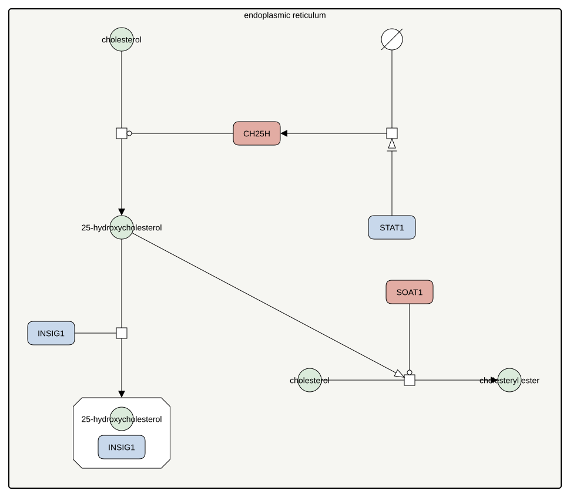

<a href="/atlas-downloads/F045-ch25h-25hc.graphml" download>GraphML<svg viewBox="0 0 24 24" width="14" height="14" fill="none" stroke="currentColor" stroke-width="2.4" stroke-linecap="round" stroke-linejoin="round" style="margin-left:3px;vertical-align:-2px" aria-hidden="true"><path d="M12 4v11M7 10l5 5 5-5"/><path d="M4 15v5h16v-5"/></svg></a> &nbsp;
<a href="/atlas-downloads/F045-ch25h-25hc.svg" download>SVG<svg viewBox="0 0 24 24" width="14" height="14" fill="none" stroke="currentColor" stroke-width="2.4" stroke-linecap="round" stroke-linejoin="round" style="margin-left:3px;vertical-align:-2px" aria-hidden="true"><path d="M12 4v11M7 10l5 5 5-5"/><path d="M4 15v5h16v-5"/></svg></a> &nbsp;

## Selection

25-Hydroxycholesterol is the oxysterol that links immune signalling to cholesterol synthesis. It is made on demand by an interferon-induced enzyme and acts on the sensing machinery of the pathway.

## Description

Interferon signalling through STAT1 turns on cholesterol 25-hydroxylase in macrophages, which hydroxylates cholesterol to 25-hydroxycholesterol (Blanc 2013, Liu 2013). The oxysterol then binds INSIG, and this is the step by which oxysterols hold the SREBP machinery in the endoplasmic reticulum, while cholesterol itself acts on SCAP instead (Radhakrishnan 2007). The same oxysterol drives the esterification of cholesterol by SOAT1, the oldest known response to it, which removes cholesterol from the accessible pool of the cell membrane and is part of its defence against infection (Brown 1975, Abrams 2020).

## References

1. Abrams ME, Johnson KA, Perelman SS, Zhang LS, Endapally S, Mar KB, Thompson BM, McDonald JG, Schoggins JW, Radhakrishnan A, Alto NM. Oxysterols provide innate immunity to bacterial infection by mobilizing cell surface accessible cholesterol. Nat Microbiol. 2020 Jul;5(7):929-942. doi: 10.1038/s41564-020-0701-5. PMID: 32284563.
1. Blanc M, Hsieh WY, Robertson KA, Kropp KA, Forster T, Shui G, Lacaze P, Watterson S, Griffiths SJ, Spann NJ, Meljon A, Talbot S, Krishnan K, Covey DF, Wenk MR, Craigon M, Ruzsics Z, Haas J, Angulo A, Griffiths WJ, Glass CK, Wang Y, Ghazal P. The transcription factor STAT-1 couples macrophage synthesis of 25-hydroxycholesterol to the interferon antiviral response. Immunity. 2013 Jan 24;38(1):106-18. doi: 10.1016/j.immuni.2012.11.004. PMID: 23273843.
1. Brown MS, Dana SE, Goldstein JL. Cholesterol ester formation in cultured human fibroblasts. Stimulation by oxygenated sterols. J Biol Chem. 1975 May 25;250(10):4025-7. PMID: 1126942.
1. Liu SY, Aliyari R, Chikere K, Li G, Marsden MD, Smith JK, Pernet O, Guo H, Nusbaum R, Zack JA, Freiberg AN, Su L, Lee B, Cheng G. Interferon-inducible cholesterol-25-hydroxylase broadly inhibits viral entry by production of 25-hydroxycholesterol. Immunity. 2013 Jan 24;38(1):92-105. doi: 10.1016/j.immuni.2012.11.005. PMID: 23273844.
1. Radhakrishnan A, Ikeda Y, Kwon HJ, Brown MS, Goldstein JL. Sterol-regulated transport of SREBPs from endoplasmic reticulum to Golgi: oxysterols block transport by binding to Insig. Proc Natl Acad Sci U S A. 2007 Apr 17;104(16):6511-8. doi: 10.1073/pnas.0700899104. PMID: 17428920.

## Contributors


