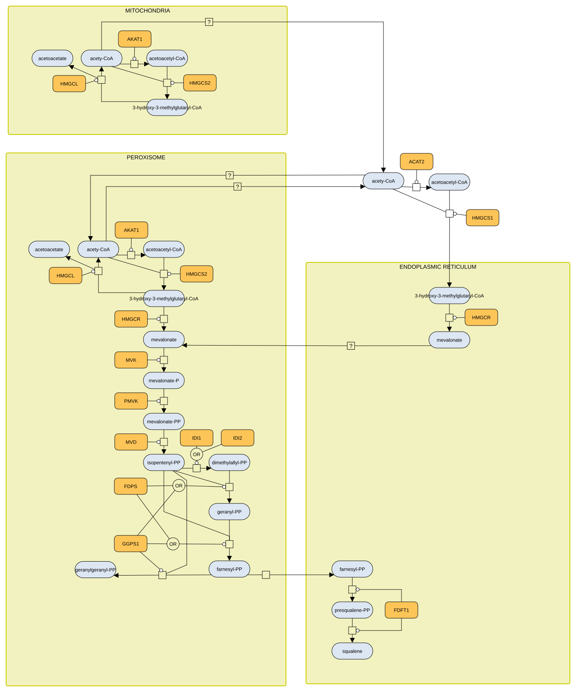
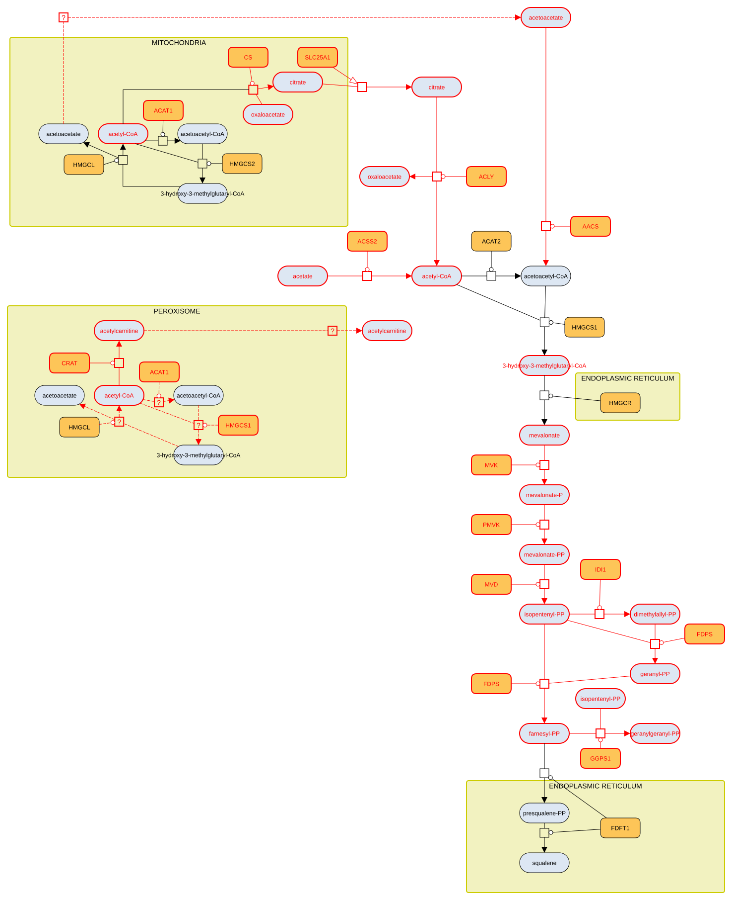

# As published (2013)

<a href="/atlas-downloads/F042-cholesterol-2013-mevalonate.graphml" download>GraphML<svg viewBox="0 0 24 24" width="14" height="14" fill="none" stroke="currentColor" stroke-width="2.4" stroke-linecap="round" stroke-linejoin="round" style="margin-left:3px;vertical-align:-2px" aria-hidden="true"><path d="M12 4v11M7 10l5 5 5-5"/><path d="M4 15v5h16v-5"/></svg></a> &nbsp;
<a href="/atlas-downloads/F042-cholesterol-2013-mevalonate.svg" download>SVG<svg viewBox="0 0 24 24" width="14" height="14" fill="none" stroke="currentColor" stroke-width="2.4" stroke-linecap="round" stroke-linejoin="round" style="margin-left:3px;vertical-align:-2px" aria-hidden="true"><path d="M12 4v11M7 10l5 5 5-5"/><path d="M4 15v5h16v-5"/></svg></a> &nbsp;

# Corrected

<a href="/atlas-downloads/F042-cholesterol-2013-mevalonate-corrected.graphml" download>GraphML<svg viewBox="0 0 24 24" width="14" height="14" fill="none" stroke="currentColor" stroke-width="2.4" stroke-linecap="round" stroke-linejoin="round" style="margin-left:3px;vertical-align:-2px" aria-hidden="true"><path d="M12 4v11M7 10l5 5 5-5"/><path d="M4 15v5h16v-5"/></svg></a> &nbsp;
<a href="/atlas-downloads/F042-cholesterol-2013-mevalonate-corrected.svg" download>SVG<svg viewBox="0 0 24 24" width="14" height="14" fill="none" stroke="currentColor" stroke-width="2.4" stroke-linecap="round" stroke-linejoin="round" style="margin-left:3px;vertical-align:-2px" aria-hidden="true"><path d="M12 4v11M7 10l5 5 5-5"/><path d="M4 15v5h16v-5"/></svg></a> &nbsp;

## Selection

The mevalonate arm of the cholesterol biosynthesis map published in 2013 (Mazein 2013, Fig. 1), shown twice: first as published, drawn from the paper's CellDesigner file, then corrected. In the corrected map everything changed is red.

## Description

The 2013 map followed the model in which the pre-squalene steps of cholesterol synthesis run in peroxisomes (Kovacs 2007): after mevalonate, every step to farnesyl diphosphate was drawn in the peroxisome only, and mevalonate made at the endoplasmic reticulum had to enter the peroxisome. Human mevalonate kinase, phosphomevalonate kinase and mevalonate diphosphate decarboxylase are cytosolic enzymes (Hogenboom 2004a, 2004b, 2004c), and fibroblasts without peroxisomes synthesise cholesterol at normal rates (Hogenboom 2003). The corrected map therefore adds the cytosolic route from mevalonate to farnesyl and geranylgeranyl diphosphate and keeps the peroxisomal steps as uncertain processes. Isopentenyl diphosphate isomerase stays peroxisomal as well, as it carries a peroxisomal targeting signal (Clizbe 2007).

HMG-CoA, mevalonate and farnesyl diphosphate are now in the cytosol: the active sites of HMG-CoA synthase 1, HMG-CoA reductase and squalene synthase face the cytosol, whereas a metabolite drawn inside a compartment sits in its lumen. HMG-CoA reductase and squalene synthase remain endoplasmic reticulum proteins.

Acetyl-CoA cannot cross the inner mitochondrial membrane. It reaches the cytosol as citrate, made by citrate synthase, carried by the mitochondrial citrate carrier and cleaved by ATP citrate lyase (Ferramosca 2014). The corrected map draws this route in place of the uncertain transport of acetyl-CoA. Two names in the CellDesigner file differ from the published figure and are corrected (ACAT1, acetyl-CoA).

## References

1. Clizbe DB, Owens ML, Masuda KR, Shackelford JE, Krisans SK. IDI2, a second isopentenyl diphosphate isomerase in mammals. J Biol Chem. 2007 Mar 2;282(9):6668-76. doi: 10.1074/jbc.M610922200. PMID: 17202134.
1. Ferramosca A, Zara V. Dietary fat and hepatic lipogenesis: mitochondrial citrate carrier as a sensor of metabolic changes. Adv Nutr. 2014 May 14;5(3):217-25. doi: 10.3945/an.113.004762. PMID: 24829468.
1. Hogenboom S, Wanders RJ, Waterham HR. Cholesterol biosynthesis is not defective in peroxisome biogenesis defective fibroblasts. Mol Genet Metab. 2003 Nov;80(3):290-5. doi: 10.1016/S1096-7192(03)00143-4. PMID: 14680974.
1. Hogenboom S, Tuyp JJ, Espeel M, Koster J, Wanders RJ, Waterham HR. Mevalonate kinase is a cytosolic enzyme in humans. J Cell Sci. 2004 Feb 1;117(Pt 4):631-9. doi: 10.1242/jcs.00910. PMID: 14730012.
1. Hogenboom S, Tuyp JJ, Espeel M, Koster J, Wanders RJ, Waterham HR. Phosphomevalonate kinase is a cytosolic protein in humans. J Lipid Res. 2004 Apr;45(4):697-705. doi: 10.1194/jlr.M300373-JLR200. PMID: 14729858.
1. Hogenboom S, Tuyp JJ, Espeel M, Koster J, Wanders RJ, Waterham HR. Human mevalonate pyrophosphate decarboxylase is localized in the cytosol. Mol Genet Metab. 2004 Mar;81(3):216-24. doi: 10.1016/j.ymgme.2003.12.001. PMID: 14972328.
1. Kovacs WJ, Tape KN, Shackelford JE, Duan X, Kasumov T, Kelleher JK, Brunengraber H, Krisans SK. Localization of the pre-squalene segment of the isoprenoid biosynthetic pathway in mammalian peroxisomes. Histochem Cell Biol. 2007 Mar;127(3):273-90. doi: 10.1007/s00418-006-0254-6. PMID: 17180682.
1. Mazein A, Watterson S, Hsieh WY, Griffiths WJ, Ghazal P. A comprehensive machine-readable view of the mammalian cholesterol biosynthesis pathway. Biochem Pharmacol. 2013 Jul 1;86(1):56-66. doi: 10.1016/j.bcp.2013.03.021. PMID: 23583456.

## Contributors


