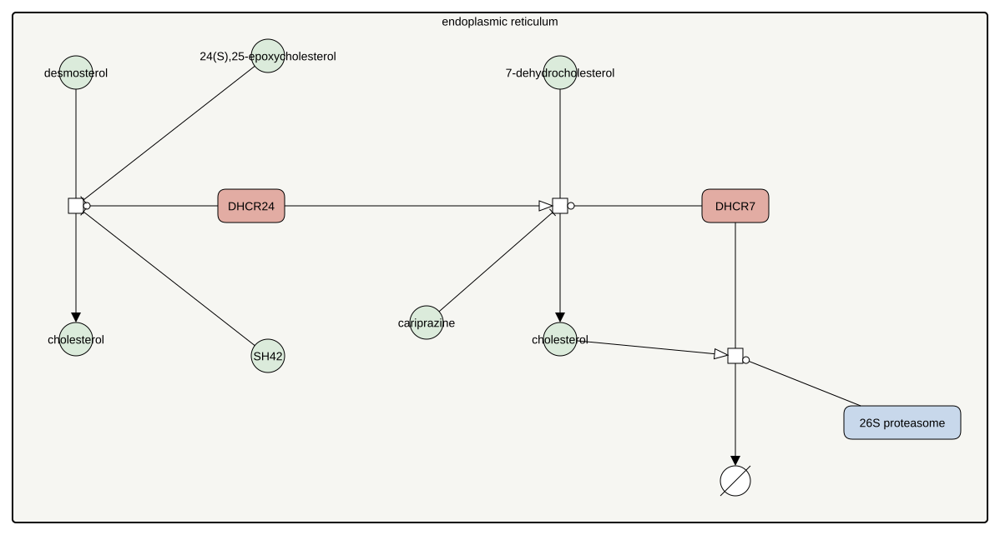

<a href="/atlas-downloads/F044-dhcr-terminal.graphml" download>GraphML<svg viewBox="0 0 24 24" width="14" height="14" fill="none" stroke="currentColor" stroke-width="2.4" stroke-linecap="round" stroke-linejoin="round" style="margin-left:3px;vertical-align:-2px" aria-hidden="true"><path d="M12 4v11M7 10l5 5 5-5"/><path d="M4 15v5h16v-5"/></svg></a> &nbsp;
<a href="/atlas-downloads/F044-dhcr-terminal.svg" download>SVG<svg viewBox="0 0 24 24" width="14" height="14" fill="none" stroke="currentColor" stroke-width="2.4" stroke-linecap="round" stroke-linejoin="round" style="margin-left:3px;vertical-align:-2px" aria-hidden="true"><path d="M12 4v11M7 10l5 5 5-5"/><path d="M4 15v5h16v-5"/></svg></a> &nbsp;

## Selection

The last step of cholesterol synthesis is reached by two routes, and each has its own reductase. The two enzymes depend on each other and are the targets of several common drugs.

## Description

Sterol Δ24-reductase makes cholesterol from desmosterol at the end of the Bloch route, and 7-dehydrocholesterol reductase makes it from 7-dehydrocholesterol at the end of the Kandutsch-Russell route. The two enzymes meet physically, and the Δ24-reductase is needed for the other to work at all, so the cell holds them as one unit (Luu 2015). Flux measurements show that most tissues reach cholesterol through a mixture of the two routes (Mitsche 2015).

The oxysterol 24(S),25-epoxycholesterol, made by the shunt that runs beside cholesterol synthesis, inhibits the Δ24-reductase without changing the amount of enzyme, so desmosterol accumulates (Zerenturk 2012). Cholesterol itself speeds the proteasomal degradation of 7-dehydrocholesterol reductase, which spares its substrate for vitamin D synthesis in skin (Prabhu 2016).

Both enzymes are drug targets. SH42 is a selective inhibitor of the Δ24-reductase (Müller 2017). Many prescription drugs inhibit the 7-dehydrocholesterol reductase as a side activity, among them cariprazine, and the sterol they leave behind accumulates in tissue (Tallman 2025).

## References

1. Luu W, Hart-Smith G, Sharpe LJ, Brown AJ. The terminal enzymes of cholesterol synthesis, DHCR24 and DHCR7, interact physically and functionally. J Lipid Res. 2015 Apr;56(4):888-97. doi: 10.1194/jlr.M056986. PMID: 25637936.
1. Mitsche MA, McDonald JG, Hobbs HH, Cohen JC. Flux analysis of cholesterol biosynthesis in vivo reveals multiple tissue and cell-type specific pathways. Elife. 2015 Jun 26;4:e07999. doi: 10.7554/eLife.07999. PMID: 26114596.
1. Müller C, Hemmers S, Bartl N, Plodek A, Körner A, Mirakaj V, Giera M, Bracher F. New chemotype of selective and potent inhibitors of human delta 24-dehydrocholesterol reductase. Eur J Med Chem. 2017 Nov 10;140:305-320. doi: 10.1016/j.ejmech.2017.08.011. PMID: 28964935.
1. Prabhu AV, Luu W, Sharpe LJ, Brown AJ. Cholesterol-mediated Degradation of 7-Dehydrocholesterol Reductase Switches the Balance from Cholesterol to Vitamin D Synthesis. J Biol Chem. 2016 Apr 15;291(16):8363-73. doi: 10.1074/jbc.M115.699546. PMID: 26887953.
1. Tallman KA, Anderson AC, Mirnics K, Porter NA, Korade Z. Post-lanosterol inhibition profile based classification of commonly used prescription medications. Transl Psychiatry. 2025 Nov 26;16(1):41. doi: 10.1038/s41398-025-03785-7. PMID: 41298375.
1. Zerenturk EJ, Kristiana I, Gill S, Brown AJ. The endogenous regulator 24(S),25-epoxycholesterol inhibits cholesterol synthesis at DHCR24 (Seladin-1). Biochim Biophys Acta. 2012 Sep;1821(9):1269-77. doi: 10.1016/j.bbalip.2011.11.009. PMID: 22178193.

## Contributors


