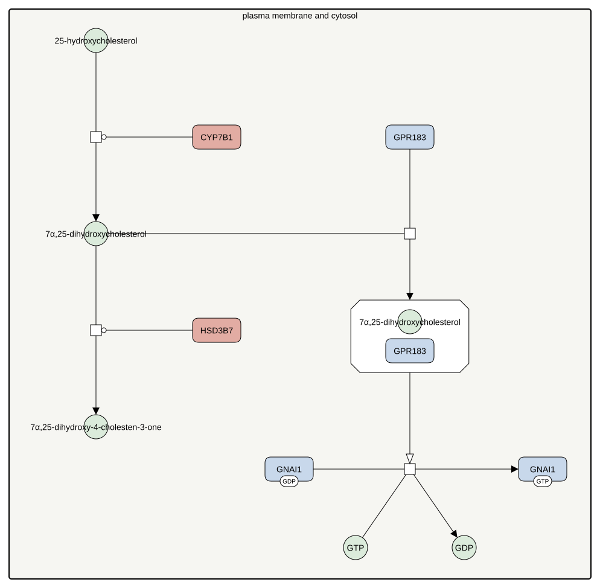

<a href="/atlas-downloads/F046-gpr183.graphml" download>GraphML<svg viewBox="0 0 24 24" width="14" height="14" fill="none" stroke="currentColor" stroke-width="2.4" stroke-linecap="round" stroke-linejoin="round" style="margin-left:3px;vertical-align:-2px" aria-hidden="true"><path d="M12 4v11M7 10l5 5 5-5"/><path d="M4 15v5h16v-5"/></svg></a> &nbsp;
<a href="/atlas-downloads/F046-gpr183.svg" download>SVG<svg viewBox="0 0 24 24" width="14" height="14" fill="none" stroke="currentColor" stroke-width="2.4" stroke-linecap="round" stroke-linejoin="round" style="margin-left:3px;vertical-align:-2px" aria-hidden="true"><path d="M12 4v11M7 10l5 5 5-5"/><path d="M4 15v5h16v-5"/></svg></a> &nbsp;

## Selection

Oxysterols made from cholesterol are not only sensors inside the cell. One of them is the ligand of a receptor on the cell surface, which guides immune cells.

## Description

CYP7B1 hydroxylates 25-hydroxycholesterol again to 7α,25-dihydroxycholesterol, the potent and selective agonist of GPR183, and HSD3B7 removes the same ligand, so the three enzymes together shape the gradient that cells follow (Yi 2012). The ligand binds the receptor with sub-nanomolar affinity and directs the migration of B cells and other immune cells, and cells without the receptor do not respond (Hannedouche 2011, Liu 2011). The receptor signals through a Gi protein and is active to a degree even without its ligand (Rosenkilde 2006).

## References

1. Hannedouche S, Zhang J, Yi T, Shen W, Nguyen D, Pereira JP, Guerini D, Baumgarten BU, Roggo S, Wen B, Knochenmuss R, Noël S, Gessier F, Kelly LM, Vanek M, Laurent S, Preuss I, Miault C, Christen I, Karuna R, Li W, Koo DI, Suply T, Schmedt C, Peters EC, Falchetto R, Katopodis A, Spanka C, Roy MO, Detheux M, Chen YA, Schultz PG, Cho CY, Seuwen K, Cyster JG, Sailer AW. Oxysterols direct immune cell migration via EBI2. Nature. 2011 Jul 27;475(7357):524-7. doi: 10.1038/nature10280. PMID: 21796212.
1. Liu C, Yang XV, Wu J, Kuei C, Mani NS, Zhang L, Yu J, Sutton SW, Qin N, Banie H, Karlsson L, Sun S, Lovenberg TW. Oxysterols direct B-cell migration through EBI2. Nature. 2011 Jul 27;475(7357):519-23. doi: 10.1038/nature10226. PMID: 21796211.
1. Rosenkilde MM, Benned-Jensen T, Andersen H, Holst PJ, Kledal TN, Lüttichau HR, Larsen JK, Christensen JP, Schwartz TW. Molecular pharmacological phenotyping of EBI2. An orphan seven-transmembrane receptor with constitutive activity. J Biol Chem. 2006 May 12;281(19):13199-13208. doi: 10.1074/jbc.M602245200. PMID: 16540462.
1. Yi T, Wang X, Kelly LM, An J, Xu Y, Sailer AW, Gustafsson JA, Russell DW, Cyster JG. Oxysterol gradient generation by lymphoid stromal cells guides activated B cell movement during humoral responses. Immunity. 2012 Sep 21;37(3):535-48. doi: 10.1016/j.immuni.2012.06.015. PMID: 22999953.

## Contributors


