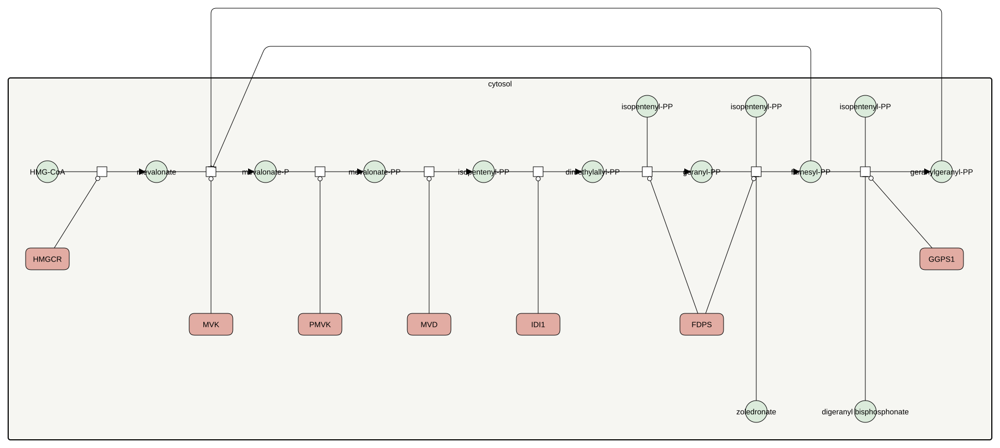

<a href="/atlas-downloads/F047-mevalonate-feedback.graphml" download>GraphML<svg viewBox="0 0 24 24" width="14" height="14" fill="none" stroke="currentColor" stroke-width="2.4" stroke-linecap="round" stroke-linejoin="round" style="margin-left:3px;vertical-align:-2px" aria-hidden="true"><path d="M12 4v11M7 10l5 5 5-5"/><path d="M4 15v5h16v-5"/></svg></a> &nbsp;
<a href="/atlas-downloads/F047-mevalonate-feedback.svg" download>SVG<svg viewBox="0 0 24 24" width="14" height="14" fill="none" stroke="currentColor" stroke-width="2.4" stroke-linecap="round" stroke-linejoin="round" style="margin-left:3px;vertical-align:-2px" aria-hidden="true"><path d="M12 4v11M7 10l5 5 5-5"/><path d="M4 15v5h16v-5"/></svg></a> &nbsp;

## Selection

The mevalonate pathway regulates itself through its own products, and several of its enzymes are drug targets. Both act on steps after the reductase that statins block.

## Description

Mevalonate kinase is inhibited by the prenyl diphosphates the pathway makes further along, in the order geranylgeranyl diphosphate, farnesyl diphosphate, geranyl diphosphate and isopentenyl diphosphate, and the inhibitors compete with ATP (Hinson 1997). The structure of the human enzyme shows the phosphate of farnesyl diphosphate lying over the place the ATP phosphate takes, and human mevalonate kinase is the most feedback-sensitive of the enzymes compared (Fu 2008). Phosphomevalonate kinase is not inhibited this way (Hinson 1997).

Nitrogen-containing bisphosphonates such as zoledronate inhibit farnesyl diphosphate synthase, binding the pocket of its allylic substrate (Kavanagh 2006, Dhar 2012). They do not inhibit the human geranylgeranyl diphosphate synthase, which lacks the residue that binds the third magnesium ion (Artz 2011), and that enzyme needs its own inhibitors, the isoprenoid bisphosphonates (Wiemer 2008).

## References

1. Artz JD, Wernimont AK, Dunford JE, Schapira M, Dong A, Zhao Y, Lew J, Russell RG, Ebetino FH, Oppermann U, Hui R. Molecular characterization of a novel geranylgeranyl pyrophosphate synthase from Plasmodium parasites. J Biol Chem. 2011 Feb 4;286(5):3315-22. doi: 10.1074/jbc.M109.027235. PMID: 21084289.
1. Dhar MK, Koul A, Kaul S. Farnesyl pyrophosphate synthase: a key enzyme in isoprenoid biosynthetic pathway and potential molecular target for drug development. N Biotechnol. 2013 Jan 25;30(2):114-23. doi: 10.1016/j.nbt.2012.07.001. PMID: 22842101.
1. Kavanagh KL, Guo K, Dunford JE, Wu X, Knapp S, Ebetino FH, Rogers MJ, Russell RG, Oppermann U. The molecular mechanism of nitrogen-containing bisphosphonates as antiosteoporosis drugs. Proc Natl Acad Sci U S A. 2006 May 16;103(20):7829-34. doi: 10.1073/pnas.0601643103. PMID: 16684881.
1. Fu Z, Voynova NE, Herdendorf TJ, Miziorko HM, Kim JJ. Biochemical and structural basis for feedback inhibition of mevalonate kinase and isoprenoid metabolism. Biochemistry. 2008 Mar 25;47(12):3715-24. doi: 10.1021/bi7024386. PMID: 18302342.
1. Hinson DD, Chambliss KL, Toth MJ, Tanaka RD, Gibson KM. Post-translational regulation of mevalonate kinase by intermediates of the cholesterol and nonsterol isoprene biosynthetic pathways. J Lipid Res. 1997 Nov;38(11):2216-23. PMID: 9392419.
1. Wiemer AJ, Yu JS, Shull LW, Barney RJ, Wasko BM, Lamb KM, Hohl RJ, Wiemer DF. Pivaloyloxymethyl-modified isoprenoid bisphosphonates display enhanced inhibition of cellular geranylgeranylation. Bioorg Med Chem. 2008 Apr 1;16(7):3652-60. doi: 10.1016/j.bmc.2008.02.016. PMID: 18308574.

## Contributors


