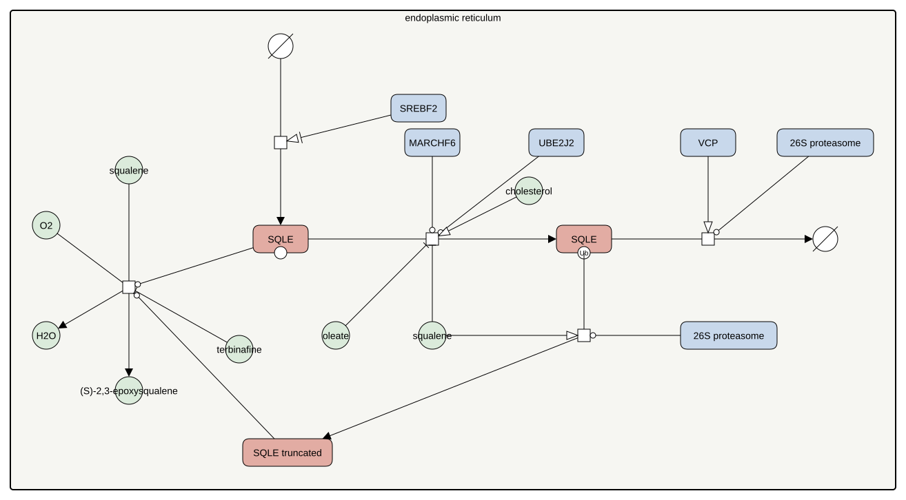

<a href="/atlas-downloads/F043-sqle-regulation.graphml" download>GraphML<svg viewBox="0 0 24 24" width="14" height="14" fill="none" stroke="currentColor" stroke-width="2.4" stroke-linecap="round" stroke-linejoin="round" style="margin-left:3px;vertical-align:-2px" aria-hidden="true"><path d="M12 4v11M7 10l5 5 5-5"/><path d="M4 15v5h16v-5"/></svg></a> &nbsp;
<a href="/atlas-downloads/F043-sqle-regulation.svg" download>SVG<svg viewBox="0 0 24 24" width="14" height="14" fill="none" stroke="currentColor" stroke-width="2.4" stroke-linecap="round" stroke-linejoin="round" style="margin-left:3px;vertical-align:-2px" aria-hidden="true"><path d="M12 4v11M7 10l5 5 5-5"/><path d="M4 15v5h16v-5"/></svg></a> &nbsp;

## Selection

Squalene monooxygenase is the second control point of cholesterol synthesis, after HMG-CoA reductase, and the first step that needs oxygen. Its regulation is post-translational and sits outside the sterol sensing that governs the reductase.

## Description

Cholesterol accelerates the proteasomal degradation of squalene monooxygenase through the first hundred residues of the enzyme, and the effector is cholesterol itself and not an oxysterol or INSIG (Gill 2011). Within that region a short amphipathic helix leaves the membrane when cholesterol is in excess and exposes the signal for degradation (Chua 2017). The ubiquitin ligase MARCHF6 carries out the ubiquitination with the conjugating enzyme UBE2J2, and it marks serines rather than lysines (Zelcer 2014, Tan 2019, Chua 2019a). The ATPase VCP then pulls the ubiquitinated enzyme out of the membrane for the proteasome (Chua 2019b).

Two signals work against this. The substrate squalene binds the same regulatory region, blocks ubiquitination by MARCHF6 and so stabilises the enzyme, a feedforward that also explains why inhibitors such as terbinafine raise the amount of enzyme while statins do not (Yoshioka 2020). Unsaturated fatty acids such as oleate stabilise it in the same way (Stevenson 2014).

The proteasome also degrades the enzyme only in part. The truncated protein that remains keeps full activity, sits on the membrane surface instead of in it, and no longer responds to cholesterol, so it is constitutively active (Coates 2021). Hypoxia drives this cut, through a more stable MARCHF6 and the squalene that accumulates when oxygen is scarce, which preserves flux when the oxygen-dependent step would otherwise stall (Coates 2023). Sterol depletion raises the gene through SREBF2 (Howe 2017).

## References

1. Chua NK, Howe V, Jatana N, Thukral L, Brown AJ. A conserved degron containing an amphipathic helix regulates the cholesterol-mediated turnover of human squalene monooxygenase, a rate-limiting enzyme in cholesterol synthesis. J Biol Chem. 2017 Dec 8;292(49):19959-19973. doi: 10.1074/jbc.M117.794230. PMID: 28972164.
1. Chua NK, Hart-Smith G, Brown AJ. Non-canonical ubiquitination of the cholesterol-regulated degron of squalene monooxygenase. J Biol Chem. 2019 May 17;294(20):8134-8147. doi: 10.1074/jbc.RA119.007798. PMID: 30940729.
1. Chua NK, Scott NA, Brown AJ. Valosin-containing protein mediates the ERAD of squalene monooxygenase and its cholesterol-responsive degron. Biochem J. 2019 Sep 20;476(18):2545-2560. doi: 10.1042/BCJ20190418. PMID: 31471528.
1. Coates HW, Capell-Hattam IM, Brown AJ. The mammalian cholesterol synthesis enzyme squalene monooxygenase is proteasomally truncated to a constitutively active form. J Biol Chem. 2021 Jan-Jun;296:100731. doi: 10.1016/j.jbc.2021.100731. PMID: 33933449.
1. Coates HW, Capell-Hattam IM, Olzomer EM, Du X, Farrell R, Yang H, Byrne FL, Brown AJ. Hypoxia truncates and constitutively activates the key cholesterol synthesis enzyme squalene monooxygenase. Elife. 2023 Jan 19;12:. doi: 10.7554/eLife.82843. PMID: 36655986.
1. Gill S, Stevenson J, Kristiana I, Brown AJ. Cholesterol-dependent degradation of squalene monooxygenase, a control point in cholesterol synthesis beyond HMG-CoA reductase. Cell Metab. 2011 Mar 2;13(3):260-73. doi: 10.1016/j.cmet.2011.01.015. PMID: 21356516.
1. Howe V, Sharpe LJ, Prabhu AV, Brown AJ. New insights into cellular cholesterol acquisition: promoter analysis of human HMGCR and SQLE, two key control enzymes in cholesterol synthesis. Biochim Biophys Acta Mol Cell Biol Lipids. 2017 Jul;1862(7):647-657. doi: 10.1016/j.bbalip.2017.03.009. PMID: 28342963.
1. Stevenson J, Luu W, Kristiana I, Brown AJ. Squalene mono-oxygenase, a key enzyme in cholesterol synthesis, is stabilized by unsaturated fatty acids. Biochem J. 2014 Aug 1;461(3):435-42. doi: 10.1042/BJ20131404. PMID: 24840124.
1. Tan JME, Cook ECL, van den Berg M, Scheij S, Zelcer N, Loregger A. Differential use of E2 ubiquitin conjugating enzymes for regulated degradation of the rate-limiting enzymes HMGCR and SQLE in cholesterol biosynthesis. Atherosclerosis. 2019 Feb;281:137-142. doi: 10.1016/j.atherosclerosis.2018.12.008. PMID: 30658189.
1. Yoshioka H, Coates HW, Chua NK, Hashimoto Y, Brown AJ, Ohgane K. A key mammalian cholesterol synthesis enzyme, squalene monooxygenase, is allosterically stabilized by its substrate. Proc Natl Acad Sci U S A. 2020 Mar 31;117(13):7150-7158. doi: 10.1073/pnas.1915923117. PMID: 32170014.
1. Zelcer N, Sharpe LJ, Loregger A, Kristiana I, Cook EC, Phan L, Stevenson J, Brown AJ. The E3 ubiquitin ligase MARCH6 degrades squalene monooxygenase and affects 3-hydroxy-3-methyl-glutaryl coenzyme A reductase and the cholesterol synthesis pathway. Mol Cell Biol. 2014 Apr;34(7):1262-70. doi: 10.1128/MCB.01140-13. PMID: 24449766.

## Contributors


